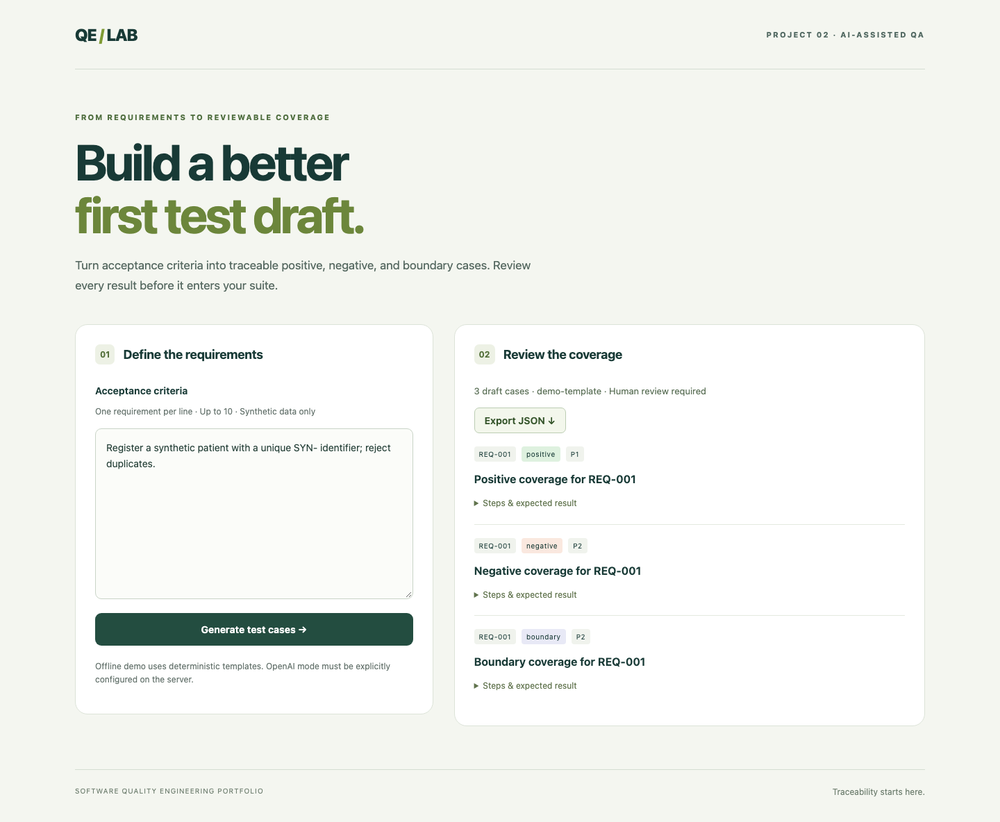

# AI-Powered Test Case Generator

**Project 02 · Repository: `ai-test-case-generator` · Python package: `ai_test_generator`**

A FastAPI + React application that converts requirements into reviewable, traceable test-case drafts. Includes deterministic offline generation and an optional OpenAI Responses API adapter plus a FreeLLMAPI chat-completions adapter. Every result remains marked `requires_review: true`.



## Implemented behavior

- One to ten requirements, each with a unique `REQ-` ID and bounded text length.
- Positive, negative, and boundary cases for every supplied requirement.
- Schema validation plus semantic checks for duplicate test IDs, missing coverage, and invented requirement IDs.
- React input form, loading/error states, expandable cases, JSON export, and responsive layout.
- Mocked upstream tests for successful output, refusal, incomplete/malformed responses, and rate-limit errors.
- API tests, Chromium UI tests, coverage, Allure results, a container recipe, and GitHub Actions.

The `demo-template` provider produces generic templates that repeat the requirement; it is not an LLM and does not claim to understand acceptance criteria. OpenAI mode provides the real LLM integration but has not been exercised with a live key in this workspace.

## Architecture

`models.py` owns the request/output contract and traceability rules. `providers.py` owns provider selection and generation. `app.py` owns HTTP responses and optional static React hosting. The browser never receives the API key. Requirements are treated as data, no generated code is executed, and responses are schema-validated before returning to the UI.

## macOS setup

```bash
/opt/homebrew/bin/python3.12 -m venv .venv
source .venv/bin/activate
python -m pip install -r requirements-dev.lock
python -m pip install --no-deps -e .
```

Use native ARM64 Python 3.12 on Apple Silicon. Install it with `brew install python@3.12` if needed. Runtime dependencies are pinned in `requirements.lock`; test/development dependencies are pinned in `requirements-dev.lock`. The lock files were resolved universally with uv. Updating dependency versions requires rerunning the verification suite.

Install a supported Node.js version (Node 22.12+ recommended; the development host used Node 26). Build the interface before running the full tests:

```bash
cd frontend
npm ci
npm run build
cd ..
python -m playwright install chromium
python -m pytest --junitxml=artifacts/junit.xml --cov=ai_test_generator --cov-report=xml:artifacts/coverage.xml
uvicorn ai_test_generator.app:create_app --factory --host 127.0.0.1 --port 8000 --no-access-log
```

Open `http://127.0.0.1:8000`. Run from this repository root so the default `frontend/dist` path resolves. For UI development, keep the API running and use `npm run dev` from `frontend`; Vite proxies `/api` to port 8000. For backend-only checks, use `python -m pytest -m 'not ui'`.

## Optional real LLM

`.env.example` is documentation; native Python does not load it automatically. Set the variables in the server environment, choosing a model available to your account that supports structured output:

```bash
export LLM_PROVIDER=openai
export OPENAI_MODEL='your-supported-model-id'
# Set OPENAI_API_KEY securely in the environment, then restart uvicorn.
```

Real mode sends submitted requirements to OpenAI and incurs normal API usage. Use synthetic requirements. Requests have a 45-second upstream timeout, a bounded output token limit, and `store: false`; this setting is not a blanket claim about provider data retention. Invalid output produces a sanitized 502 response. There are no automatic retries or silent fallbacks to demo output.

## FreeLLMAPI setup and live verification

The desktop gateway on this machine is `http://127.0.0.1:31415/v1`. Its unified key is configured in the ignored, owner-readable `.env`; no key is committed or included in reports. A live synthetic generation request passed schema and traceability validation.

For a fresh installation, create a local `.env` with:

```dotenv
LLM_PROVIDER=freellmapi
FREELLMAPI_BASE_URL=http://127.0.0.1:31415/v1
FREELLMAPI_API_KEY=<your-unified-key>
FREELLMAPI_MODEL=auto
```

Load your local configuration before launching:

```bash
set -a
source .env
set +a
uvicorn ai_test_generator.app:create_app --factory --host 127.0.0.1 --port 8000 --no-access-log
```

`auto` follows your gateway's routing configuration. The adapter requests JSON output, then independently validates its schema, unique IDs, and coverage of all submitted requirements. JSON mode is not a guarantee of model compliance; incomplete, malformed, refused, or semantically invalid output returns a sanitized 502. Calls have a 45-second upstream timeout. Human review is still required for correctness and unstated assumptions.

For the Dockerized generator connecting to the desktop gateway, set `FREELLMAPI_BASE_URL=http://host.docker.internal:31415/v1` instead; localhost inside a container refers to the container itself. Native live generation was verified; actual upstream availability and limits depend on your FreeLLMAPI configuration. [Official API reference](https://github.com/tashfeenahmed/freellmapi/blob/main/docs/en/api/01-rest-api.md).

## API example and portfolio connection

```bash
curl -sS http://127.0.0.1:8000/api/generate \
  -H 'Content-Type: application/json' \
  --data-binary @examples/requirements.json
```

The example requirements map to Project 03's patient registration and appointment-conflict rules. Exported JSON uses `schema_version: 1.0`; it is a human-review artifact, not an executable test suite. Developers translate accepted drafts into Project 01/03 tests.

## Containers, reports, and CI

`docker compose up --build` serves the full app at port 8000 with demo mode by default. The multi-stage Dockerfile builds React and installs only runtime Python dependencies in a non-root container. Docker Compose reads `.env` if provided.

Pytest writes Allure results to `artifacts/allure-results`, and failed UI tests retain Playwright diagnostics in `artifacts/playwright`. Install Allure separately (`brew install allure`) and run `allure serve artifacts/allure-results`. Default runs replace the prior Allure result set. CI installs pinned dependencies, builds React, runs tests/lint/coverage, and builds the Docker image.

## Limits and next increment

This is a local portfolio app without user authentication, persistence, provider quotas, or a production ingress. Keep it bound to loopback until those controls exist. The next increment should add evaluation datasets and scored generation quality, review persistence, and authenticated usage limits. Python coverage does not measure React code coverage; React behavior is tested through Chromium.

See [VALIDATION.md](VALIDATION.md) for executed evidence. References: [FastAPI testing](https://fastapi.tiangolo.com/tutorial/testing/), [OpenAI structured outputs](https://developers.openai.com/api/docs/guides/structured-outputs), [Vite setup](https://vite.dev/guide/).
